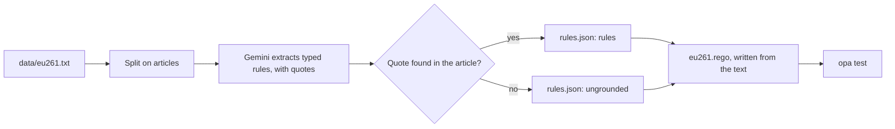
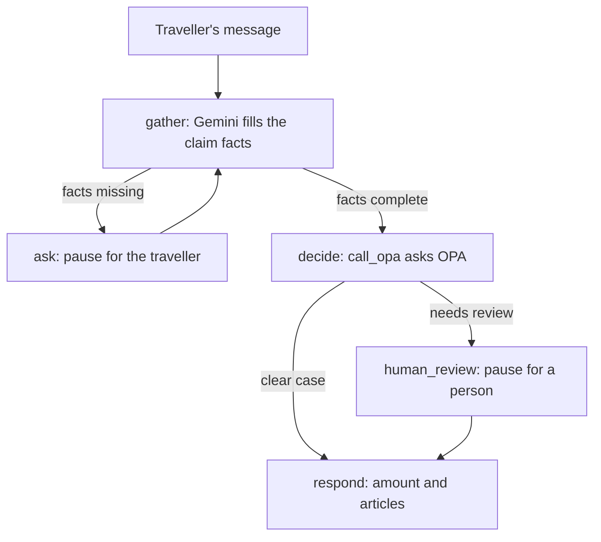

# Mini policy as code on EU261

A small prototype that turns a real regulation into tested, executable rules with
citations. An agent sits in front of the rules: it decides compensation claims and hands
the cases that need judgement to a person.

The regulation is EU Regulation 261/2004, the EU's rules on compensation for cancelled
and delayed flights. It's short, and it has the traps legal AI runs into: an exception
(Article 5(3)), an open term ("extraordinary circumstances"), and a rule that lives in
case law rather than the text (delay compensation, from *Sturgeon*, 2009).

Built with Claude Code. A learning prototype, not legal advice.

## How it works

The model never decides who gets paid. It drafts the rules, which code and people check,
and it reads the traveller's facts. The policy engine decides, and a person handles what
the law leaves open.

### Build time: turn the law into rules



1. **Split** the regulation on its article headings, so every rule can cite where it
   came from (`pac/split.py`).
2. **Extract** each article with Gemini into a typed schema: obligation, permission or
   prohibition; who it binds; conditions; exceptions; and the exact source sentence
   (`pac/extract.py`, schema in `pac/schema.py`). Rule IDs are assigned in code, and each
   article's result is cached in `data/extracted/<model>/`.
3. **Check each quote** against its article in code. Rules whose quote isn't found word
   for word in the article (ignoring whitespace) go to the `ungrounded` list in
   `rules.json`.
4. **Write the policy** in Rego (`policy/eu261.rego`) from the regulation text, using
   `rules.json` as a checklist. Each rule is commented with the provision it implements.
5. **Test** the policy against worked examples (`policy/eu261_test.rego`).

### Run time: decide a claim



1. **gather:** Gemini fills a form of claim facts from the traveller's message, and is
   told to leave anything unsaid empty.
2. **ask:** if a required fact is missing, the agent pauses, asks for it, then gathers again.
3. **decide:** the agent asks OPA for a decision through `call_opa`, which fails closed
   if OPA is unreachable or returns no decision.
4. **human_review:** if OPA says a person must decide, for example because the airline
   claims extraordinary circumstances, the run pauses until a reviewer resumes it.
5. **respond:** the reply gives the amount and the articles. If the cause of the
   disruption is unknown, it adds "unless the airline proves extraordinary
   circumstances (Art. 5(3))".

The agent is a LangGraph graph with a checkpointer, so a paused claim resumes where it
stopped. The FastAPI endpoint `/decide` exposes the same policy decision over HTTP.

## Repository layout

| Path | What it is |
|---|---|
| `data/eu261.txt` | The regulation's text |
| `data/extracted/` | Cached extraction results, one file per article per model |
| `pac/split.py` | Splits the text into articles |
| `pac/schema.py` | The rule schema and the quote check |
| `pac/extract.py` | Extraction with Gemini, through Instructor |
| `rules.json` | The extraction output, unedited: passing and rejected rules |
| `policy/eu261.rego` | The policy |
| `policy/eu261_test.rego` | Policy tests from worked examples |
| `app/main.py` | The `/decide` endpoint and `call_opa` |
| `app/agent.py` | The LangGraph claims agent |
| `chat.py` | A terminal chat with the agent |
| `check.py`, `probe.py` | Scripts used to diagnose Gemini timeouts and find a model that answers |
| `NOTES.md` | What broke, what the extraction got wrong, and what I'd do next |

## Running it

You need Python 3.12, uv, Docker and a Gemini API key.

```bash
uv sync
cp .env.example .env   # then add your GEMINI_API_KEY
docker run -d --name opa -p 8181:8181 -v "$PWD/policy:/policy" \
  openpolicyagent/opa:latest run --server --watch --addr 0.0.0.0:8181 /policy
```

Extract the rules. Results are cached per article, so a rerun only redoes failures; with
the cache in this repo, it rebuilds `rules.json` without calling Gemini:

```bash
uv run --env-file .env python -m pac.extract
```

Test the policy (all 7 tests should pass):

```bash
docker run --rm -v "$PWD/policy:/policy" openpolicyagent/opa:latest test /policy -v
```

Call the API:

```bash
uv run uvicorn app.main:app

# in a second terminal:
curl -s localhost:8000/decide -H 'content-type: application/json' \
  -d '{"disruption":"cancellation","distance_km":900,"departs_eu":true,"notice_days":2,"reroute_depart_early_h":0,"reroute_arrive_late_h":5}'
# {"amount_eur":250,"carrier_may_halve":false,"citations":["Art. 3(1)","Art. 7(1)"],"eligible":true,"needs_human_review":false}
```

Chat with the agent:

```bash
uv run --env-file .env python chat.py
```

```
Traveller: my flight from dublin to barcelona was cancelled
Agent: roughly how long was the flight, in km? how many days' notice of the cancellation did you get?
Traveller: 1500km, 2 days
Agent: Eligible: True, EUR 250 (Art. 3(1), Art. 7(1)), unless the airline proves extraordinary circumstances (Art. 5(3))
```

## Design decisions
- The claim's facts and the policy decide eligibility, never the model's opinion. The
  policy's defaults are "no".
- Every decision carries the articles it rests on.
- Open terms such as "extraordinary circumstances" go to a person, not the model.
- Case law the text doesn't contain (Sturgeon) is encoded explicitly and cited.
- Gemini is reached through its OpenAI-compatible endpoint, so changing provider is a
  configuration change.

## Limitations
- One regulation. The policy was written with AI assistance and checked by hand against
  the text; it isn't generated from the extraction (see `NOTES.md` for how I'd close
  that gap).
- The extraction has known errors, documented in `NOTES.md`, and there's no gold-set
  evaluation yet.
- Article 3(2) (confirmed reservation, on-time check-in) isn't covered.
- The traveller supplies the distance and whether the flight left the EU. A real system
  would work these out from the airports, and take the cause of the disruption from the
  airline's records.
- The checkpointer is in memory, so paused claims are lost when the process stops.
  Production would use Postgres.
- No authentication. Not legal advice.

## Source

The text of Regulation (EC) No 261/2004 is legislation.gov.uk's original version, as
adopted, not today's UK version.